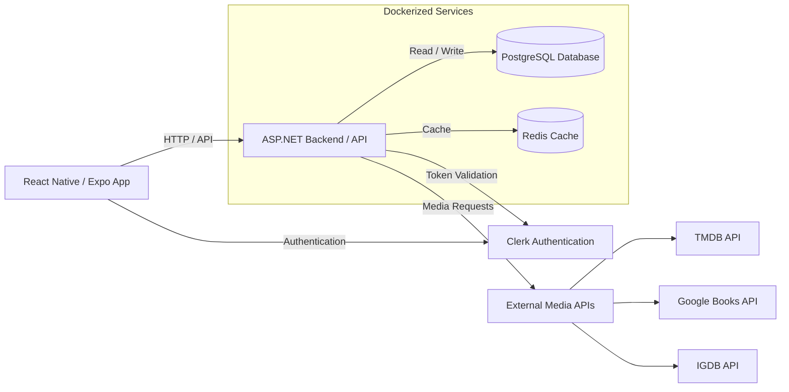

# System Architecture

This document describes the planned system architecture for **Palette**, a cross-media tracking and discovery application. It will be updated as the project evolves and architectural decisions are made.

## 1. Architecture Overview

Palette uses a client-server architecture with a React Native frontend, an ASP.NET backend, and supporting data services.

## 2. Components

### Frontend

- React Native with Expo for cross-platform development.
- Provides media search, detail screens, and My Library. The library reuses category list and detail components across media types.
- Communicates with the backend through HTTP APIs.

### Backend

- ASP.NET Core Web API.
- Handles business logic, database operations, and communication
  with external services.
- Uses Entity Framework Core for database access.

### Database

- PostgreSQL 17 is hosted on Supabase for the production environment.
- Local development PostgreSQL 17 may also run through Docker Compose.
- Stores application-specific data such as users, media records,
  and other persisted user activity. My Library uses `USER_MEDIA_LOGS` to associate saved items with each user.

### External Services

- TMDB provides movie and TV show information, including
  searchable metadata and media details.
- Google Books provides book metadata and details.
- IGDB provides game metadata and details.

### Authentication

- Clerk handles user authentication.
- The frontend uses Clerk for login, while the backend validates authentication tokens.

### Future Components

- Redis caching may be introduced when needed.
- Additional external media providers may be integrated.

## 3. Deployment

The ASP.NET Core Web API is containerized using Docker and hosted on Render using the free tier. GitHub Actions builds and pushes backend images to Docker Hub after backend changes are merged into `master`, and the workflow triggers a Render deploy hook to update the running service.

The backend runs in the `Production` environment. Its database connection string and API credentials are configured as Render environment variables. The backend connects to the Supabase PostgreSQL database using that connection string. EF Core migrations are not applied automatically in production; schema changes are applied separately to Supabase.

During local development, PostgreSQL may run in a Docker container while the ASP.NET Core backend and Expo frontend run as local development processes. The application can be started using the unified development command described in the Local Setup Guide.

## 4. Future Updates

This architecture represents the current plan and may change during development. This document will be updated as new technologies, services, or architectural decisions are introduced.
