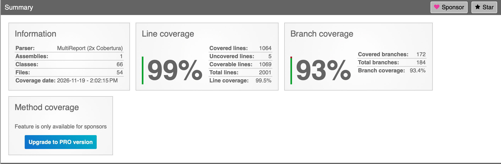

# Testing Documentation

This document describes Palette’s backend and frontend test suites and backend coverage evidence.

## 1. Testing Strategy

Palette uses unit tests and integration tests to verify application behaviour and interactions between components.

The backend regression suite covers:

- Search and lookup for movies, TV shows, and books.
- My Library membership, category previews, and cover persistence.
- Input validation, boundary values, missing data, and failure handling.
- External-provider request construction and response processing.
- HTTP response contracts and application middleware.
- PostgreSQL persistence, constraints, relationships, and cascade deletion.

The complete backend suite is run through `tests/Palette.Tests.csproj`. Running the full suite provides regression checks across shared components when the application changes.

Coverage percentages help identify untested code, but do not establish that every requirement or user workflow has been verified. Test selection also considers behaviour, component interactions, failure conditions, and user-story acceptance criteria.

## 2. Unit Testing

### Tools and Frameworks

- **xUnit:** Test execution and assertions.
- **EF Core InMemory:** Existing lightweight database-model tests.
- **Custom test doubles:** Controlled provider responses and recorded calls.
- **Stub HTTP handlers:** Simulated TMDB responses without external requests.

### Tested Components

| Component                  | Tested behaviour                                                                                                                                                                        |
| -------------------------- | --------------------------------------------------------------------------------------------------------------------------------------------------------------------------------------- |
| SearchService              | Missing queries, query-length boundaries, trimming, provider selection, result-limit forwarding, empty results, errors, and cancellation                                                |
| LookupService              | Missing IDs, trimming, provider selection, cancellation-token forwarding, and error propagation                                                                                         |
| MediaProviderResolver      | Case-insensitive resolution, unknown types, duplicate registrations, and independent provider selection                                                                                 |
| TmdbMapper                 | Movie and TV mapping, dates, poster URLs, descriptions, runtimes, season counts, and missing optional values                                                                            |
| ProviderCallGuard          | Successful calls, HTTP and JSON failures, upstream cancellation, caller cancellation, and unexpected exceptions                                                                         |
| TmdbClient                 | Request paths, query encoding, response deserialization, HTTP failures, invalid responses, and cancellation                                                                             |
| Movie and TV providers     | ID validation, result limits, mapping, missing items, provider failures, and cancellation                                                                                               |
| ApiExceptionHandler        | ProblemDetails responses, trace IDs, logging levels, internal-detail protection, and unhandled exceptions                                                                               |
| TMDB configuration         | Required settings, URL validation, timeout boundaries, defaults, client configuration, and provider registration                                                                        |
| GoogleBooksMapper          | Search and lookup mapping, published-date formats (full, month, year), HTTPS poster URLs, ISBN-13/ISBN-10 priority and trimming, HTML description cleaning, and missing optional values |
| GoogleBooksClient          | Request paths, query and volume-id escaping, response deserialization, 503 treated as not found, HTTP failures, empty or invalid bodies, required fields, and cancellation              |
| Google Books provider      | Result mapping and order, empty results, missing volume to `MediaNotFoundException`, provider failures, and cancellation                                                                |
| Google Books configuration | Required and valid BaseUrl, trailing slash, optional API key header, default timeout, client configuration, and provider registration                                                   |

EF Core InMemory tests are not used as evidence that PostgreSQL constraints or database-side cascade deletion work correctly. Those behaviours are verified separately against PostgreSQL.

## 3. Integration Testing

### HTTP API Integration Tests

HTTP integration tests use ASP.NET Core TestServer and the real endpoint, service, provider, mapper, and error-handling implementations.

`ApplicationStartupTests` and `SearchAndLookupApiTests` execute the real `Program.cs` through `PaletteApplicationFactory`. Tests replace the external TMDB and Google Books HTTP transport and register a test authentication scheme. The real fallback authorization policy, exception handling, `EnsureUserExistsMiddleware`, `UserService`, and PostgreSQL persistence remain active.

`TestAuthenticationHandler` authenticates only when the test client sends `X-Test-User`. It supplies a controlled Clerk ID, username, and email; clients without that header remain anonymous. This scheme is registered only by test factories. A dummy `Clerk:FrontendAPIURL` supplies startup configuration; these tests make no Clerk calls and do not validate real JWT signatures, expiry, issuers, or Clerk connectivity.

Both classes share the existing migrated `PostgresFixture`, use unique test identities, and delete users they provision. An identity does not bypass user provisioning. `HealthEndpointsTests` remains a small endpoint-only test; authorization assertions belong to the real-entry-point tests.

Tests that do not excercise books uses a handler that throws on any Google Books request, so not test can reach the network by accident.

Tests cover:

- Movie, TV and Book search results, empty results, and result limits (the book limit is forwarded to Google Books as `maxResults`).
- Movie, TV and Book lookup responses, including media-specific fields (book `isbn`, cleaned description, HTTPS poster).
- Missing optional data.
- Invalid requests and unsupported media types.
- HTTP 400, 404, and 502 responses under a controlled authenticated identity.
- Anonymous movie/TV search and lookup requests return 401 before business validation or provisioning.
- `/api/test` stays public, including CORS requests without authentication.
- `/api/health` requires authentication in the current application; it has no `AllowAnonymous` metadata.
- Authenticated first requests provision a user, and subsequent requests reuse the row without overwriting the stored profile.
- ProblemDetails content types, response fields, and trace IDs.
- Protection against leaking upstream error details.
- Book lookup of an unknown volume returns 404 (Google Books reports it as HTTP 503), while a 503 on search returns 502.

These tests do not require a real TMDB account, token or Google Books API key.

### My Library Integration Tests

`LibraryTests` exercises the real authenticated endpoints using `PostgresFixture` and stub media providers. It covers adding and removing all three media types, concurrent and repeated saves, account isolation, saved state in lookup responses, the 12-item preview limit, and backfilling missing covers.

### Application Startup Tests

WebApplicationFactory starts the application’s actual entry point using isolated `Testing` and `Development` configurations.

Startup tests verify:

- Authenticated health and anonymous backend connection endpoints.
- Movie and TV search registration.
- CORS behaviour for allowed and other origins.
- CORS preflight handling.
- Application exception-handling middleware.
- Bearer authority and validation settings, including rejection of a missing Clerk URL, without fetching Clerk metadata.

Development startup tests additionally verify:

- Automatic application of migrations to a fresh PostgreSQL database.
- Authenticated access to the OpenAPI document and expected API paths; anonymous OpenAPI requests return 401 under the current fallback policy.
- HTTP-to-HTTPS redirection while preserving the path and query string.
- Successful HTTPS requests without another redirect.

These tests use a separate temporary database. The test fixture does not apply migrations before application startup, so the tests verify that Program.cs performs the migration.

### PostgreSQL Integration Tests

Database integration tests use PostgreSQL 17 and the application’s EF Core migrations.

The shared `PostgresFixture` uses Testcontainers to manage a temporary database when no explicit test connection is supplied.

Database tests cover:

- Persistence and retrieval.
- Movie, TV, Book, and Game relationships with Media.
- Unique external identifiers.
- User email and external-identity uniqueness.
- Required database fields.
- Review and UserMediaLog foreign keys.
- Collection and CollectionItem relationships.
- CollectionItem composite-key uniqueness.
- Database-side cascade deletion.
- Preservation of unrelated records when deleting related entities.

Tests clear EF tracking where necessary so that assertions verify database reads and PostgreSQL behaviour rather than only the tracked object graph.

Most database test data is isolated using transactions that roll back after each test. User-provisioning race and unique-email failure tests require committed writes and use unique identities with explicit cleanup instead.

### User Provisioning

PR #80 already supplies `tests/Features/Users/UserServiceTests.cs`, which simulates a duplicate Clerk ID during a save using EF InMemory and verifies that middleware continues. That regression test is retained unchanged.

Additional coverage lives in `tests/Unit/Users/UserProvisioningTests.cs`, `tests/Integration/Database/UserProvisioningDatabaseTests.cs`, and the real-entry-point startup tests:

- Missing request/claims and invalid existence-query arguments.
- Anonymous or missing/blank Clerk identity skips provisioning and continues the pipeline without database access.
- Missing username/email fails provisioning and does not invoke the next middleware delegate.
- First creation, existence lookup, explicit service profile updates, and preservation of identity/join date.
- Cancellation propagation and unrelated PostgreSQL email-uniqueness failures.
- Two concurrent first creations with separate DbContexts and real PostgreSQL unique-index enforcement. A shared asynchronous save interceptor holds both contexts after their absent-user SELECTs until both reach saving, then permits real INSERTs. Distinct emails isolate the Clerk ID constraint. The test asserts one actual PostgreSQL `23505` error on `IX_USERS_ClerkId`, recovery to the same persisted user, and detachment of the losing insert. A bounded cancellation token prevents a broken coordination path from hanging. No sleeps or synthetic database errors are used in this test.

The startup tests also establish the current middleware behavior: it provisions absent users, but does not update an existing profile on every HTTP request. Explicit `SaveCurrentUserAsync` calls do update the profile.

## 4. Mocking and Test Utilities

### StubMediaProvider

`StubMediaProvider` implements the existing `IMediaProvider` interface.

Service tests configure its responses and inspect recorded calls. Unexpected, unconfigured calls fail rather than silently returning successful results.

### Stub HTTP Handlers

Stub handlers provide deterministic HTTP responses to the real `TmdbClient` and `GoogleBooksClient`.

They simulate successful responses, missing items, invalid JSON, network errors, and cancellation. Automated tests do not depend on live TMDB data or availability.

### Testcontainers and PostgresFixture

Without `PALETTE_TEST_DB_CONNECTION`, the fixture:

1. Creates a temporary PostgreSQL 17 container.
2. Uses an available host port.
3. Waits for the database to start.
4. Applies EF Core migrations.
5. Shares the database across the PostgreSQL test collection.
6. Disposes of the temporary container after testing.

If `PALETTE_TEST_DB_CONNECTION` is supplied, the fixture uses that connection instead. The override is restricted to the designated local test database to reduce the risk of running tests against development data.

Testcontainers manages only the containers it creates. An externally supplied database remains managed by its owner.

`DevelopmentApplicationFixture` always creates a separate temporary PostgreSQL 17 container for Development startup tests, regardless of `PALETTE_TEST_DB_CONNECTION`. It inspects the fresh database before startup and lets Program.cs apply migrations. The application is disposed before the temporary container is removed.

## 5. Running Tests

### Prerequisites

- .NET 10 SDK.
- Docker Desktop or a compatible Docker environment.
- A running Docker engine.

The first execution may need network access to restore NuGet packages and download container images.

### Run All Backend Tests

From the repository root:

```bash
dotnet test tests/Palette.Tests.csproj
```

With the default Testcontainers setup, no manual database creation, connection-string export, or local environment file is required.

For tests using `PostgresFixture`, an existing `PALETTE_TEST_DB_CONNECTION` overrides automatic database creation, and the configured database must be available. Development startup tests always create their own temporary database and require Docker.

### Run Frontend Tests

Use Node.js 24 and run the following from the repository root:

```bash
npm ci --prefix frontend
node --test 'tests/frontend/**/*.test.cjs'
```

| Suite | Tested behaviour |
| --- | --- |
| `tests/frontend/my-library.test.cjs` | Poster navigation and fallback, the manual refresh animation trigger, immediate Add/Remove feedback and rollback, authenticated requests, and timeouts |
| `tests/frontend/reset-password.test.cjs` | Resuming a valid attempt after going back, retrying a rejected password after code verification, recovering from resend failures or missing attempts, countdown after initial send and resend, and clearing errors after five seconds or on navigation |

The suites use Node’s test runner and mock UI, navigation, and external dependencies. The password reset suite uses a simulated clock to check the countdown and error timeout.

### Run Only Unit Tests

```bash
dotnet test tests/Palette.Tests.csproj \
  --filter "FullyQualifiedName~Palette.Tests.Unit"
```

Tests under `Palette.Tests.Unit` do not require PostgreSQL.

### Run HTTP Integration Tests

```bash
dotnet test tests/Palette.Tests.csproj \
  --filter "FullyQualifiedName~Palette.Tests.Integration.Api"
```

The current HTTP tests use isolated application settings and simulated TMDB responses where TMDB is exercised.

This filter requires Docker: startup and search/lookup tests now use the shared PostgreSQL fixture for user provisioning. `DevelopmentStartupTests` additionally create a separate temporary PostgreSQL database.

To run authentication/provisioning and API regression tests together:

```bash
dotnet test tests/Palette.Tests.csproj \
  --filter "FullyQualifiedName~UserProvisioning|FullyQualifiedName~Integration.Api|FullyQualifiedName~UserServiceTests"
```

### Run PostgreSQL Integration Tests

```bash
dotnet test tests/Palette.Tests.csproj \
  --filter "FullyQualifiedName~Palette.Tests.Integration.Database"
```

Docker must be running unless an available external test database is explicitly configured.

### Run One Test Class

For example:

```bash
dotnet test tests/Palette.Tests.csproj \
  --filter "FullyQualifiedName~MediaSubtypeDatabaseTests"
```

## 6. Test Coverage and Regression Evidence

### Collect Coverage

The test project includes Coverlet. Coverage settings are defined in `tests/coverage.runsettings`.

Run the following commands from the repository root in the same terminal:

```bash
coverage_run="TestResults/coverage-$(date +%Y%m%d-%H%M%S)"

dotnet test tests/Palette.Tests.csproj \
  --collect:"XPlat Code Coverage" \
  --settings tests/coverage.runsettings \
  --results-directory "$coverage_run" \
  --logger "trx;LogFileName=backend-tests.trx"
```

This produces:

- A TRX test execution report.
- A Cobertura XML coverage report.

Each execution uses a separate results directory to avoid combining reports from different runs unintentionally.

### Generate an HTML Report

Install ReportGenerator once:

```bash
dotnet tool install --global \
  dotnet-reportgenerator-globaltool \
  --version 5.6.0
```

Generate the report:

```bash
"$HOME/.dotnet/tools/reportgenerator" \
  "-reports:$coverage_run/**/coverage.cobertura.xml" \
  "-targetdir:$coverage_run/html" \
  "-reporttypes:Html"
```

On macOS, open it with:

```bash
open "$coverage_run/html/index.html"
```

On other platforms, open the generated `index.html` in a browser.

### Coverage Scope

The report measures the backend application assembly and excludes:

- EF Core migration classes and model snapshots.
- OpenAPI-generated code.
- Compiler support types.

These exclusions separate generated infrastructure from application code. Database migrations are still used to initialize test databases.

`Program.cs`, application services, providers, mappings, error handling, the DbContext, and entity models remain included.

Exclusion rules should be kept consistent between local and CI reports and documented whenever they change.

### Latest Test Results

Last verified locally: November 19, 2026.

- **Full backend suite: 471 passed with no failures or skips.**
- **Line coverage: 99.5% — 1064 of 1069 lines.**
- **Branch coverage: 93.4% — 172 of 184 branches.**



### Continuous Integration

The workflow at `.github/workflows/ci.yml` runs on pull requests, pushes to `develop` or `master`, and manual dispatch. It runs **Frontend Tests** and **Backend Tests** as separate jobs. The frontend job installs dependencies from the frontend lockfile and runs all matching tests under `tests/frontend/`. The backend job collects and publishes backend coverage.

The coverage-enabled workflow update is pending verification through a pull request. After it runs successfully, milestone documentation should link to:

- The actual workflow execution.
- The test result and coverage artifacts.
- The coverage summary.
- The tested commit.

A green test execution alone is not a coverage report.

If a regression test fails, investigate whether the implementation regressed, the test is unreliable, or the intended contract changed. Fix the cause and rerun the affected tests and full suite before considering the change ready.

## 7. Current Limitations and Follow-Up Work

- **HTTPS transport:** TestServer tests verify HTTPS redirection and request handling, but do not validate a real TLS handshake, certificates, or deployed HTTPS configuration.
- **Device coverage:** Frontend tests use mocked components and services. Visual layout, touch gestures, live sign-in, and password reset email delivery still need device checks.
- **Real external services:** Simulated TMDB responses verify application behaviour but do not prove that live TMDB credentials or deployed connectivity are correct.
- **Acceptance criteria:** User-story acceptance criteria still need an explicit mapping to automated tests or recorded manual checks.
- **CI evidence:** The updated coverage collection and artifact publication must be verified after the pull request is created.
- **Deployed workflows:** Local automated tests do not replace representative checks of the deployed application.
- **Clerk JWT validation:** The controlled authentication scheme tests authorization and provisioning, but does not establish production bearer-token validation. Offline signed-token tests for invalid signatures, issuer, and expiration remain a possible follow-up; live Clerk calls are outside this suite.
- **Custom migrations:** Future migrations containing hand-written data transformations should receive dedicated upgrade/data-preservation tests even though migration classes are excluded from the application coverage metric.

Testing is a shared team responsibility. Feature changes should include relevant regression tests, and the testing documentation should be updated as functionality and known gaps change.
